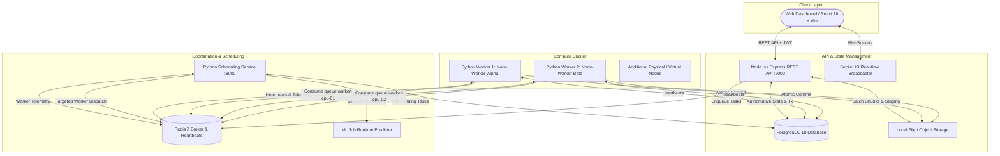

# Distributed AI/ML Job Processing Platform
### Intelligent Resource-Aware Scheduling, Predictive Dispatch, and Fault Tolerance

[](https://nodejs.org/)
[](https://www.python.org/)
[](https://www.postgresql.org/)
[](https://redis.io/)
[](https://react.dev/)
[](https://www.docker.com/)

---

## 1. Project Overview & Problem Statement

Modern machine learning workloads—ranging from high-throughput batch inference to hyperparameter tuning and data preprocessing—are computationally demanding and unevenly distributed. Traditional naive FIFO or static round-robin scheduling algorithms ignore real-time hardware constraints (CPU saturation, available RAM, GPU presence, socket lease timeouts), leading to queue head-of-line blocking, memory thrashing, and prolonged job turnaround times.

This project delivers a **production-minded, distributed task-processing platform** designed to solve these challenges. It provides asynchronous job intake, deterministic batch partitioning, intelligent resource-aware and ML-predictive task scheduling, genuine hardware telemetry reporting via `psutil`, transparent fault recovery with exponential backoff and worker lease timeouts, idempotent atomic result commits, and an interactive real-time dashboard.

---

## 2. System Architecture



---

## 3. Technology Stack

| Layer | Technologies | Rationale |
| :--- | :--- | :--- |
| **Frontend** | React 18, Vite, TypeScript, Tailwind CSS, Recharts, TanStack Query, Lucide Icons, Socket.IO Client | Ultra-responsive, glassmorphic dark UI with live streaming telemetry, interactive charts, and zero placeholder data. |
| **Backend API** | Node.js 22, Express.js, TypeScript, PostgreSQL Pool (`pg`), Zod, JWT + Bcrypt | Authoritative job lifecycle controller, transactional safety, role-based access control, and batch partitioning. |
| **Scheduler** | Python 3.11, FastAPI, Uvicorn, scikit-learn, joblib | Decoupled intelligent scheduling engine running Round-Robin, Least-Loaded, Resource-Aware, and Predictive algorithms. |
| **Workers** | Python 3.11, Redis Client, `psutil`, Celery | Independent processes reporting genuine hardware metrics, executing approved workloads, and renewing task leases. |
| **ML Engine** | scikit-learn, pandas, NumPy, joblib, PyTorch | Workload handlers for batch inference, data preprocessing, model evaluation, and runtime regression prediction. |
| **Database** | PostgreSQL 16/18 | 13 normalized tables with foreign keys, constraints, and UTC timestamps. |
| **Broker** | Redis 7 | High-performance distributed queues and fast in-memory worker telemetry heartbeat store. |
| **Observability**| Prometheus, Grafana, Structured JSON Logs | Scrapes HTTP metrics, scheduler latency, queue depth, and worker utilization. |

---

## 4. Database Schema

The relational database in PostgreSQL ensures authoritative consistency:

```
users (id, username, email, password_hash, role, created_at, updated_at)
refresh_tokens (id, user_id, token_hash, expires_at, revoked, created_at)
workers (id, name, hostname, status, max_concurrency, cpu_cores, total_ram_mb, has_gpu, supported_job_types, drain_mode, last_heartbeat_at)
jobs (id, user_id, name, description, job_type, status, scheduling_strategy, priority, dataset_path, result_path, total_batches, completed_batches)
job_batches (id, job_id, batch_index, total_batches, record_start_index, record_count, status, chunk_path)
job_tasks (id, job_id, batch_id, task_type, status, assigned_worker_id, lease_expires_at, retry_count, input_data_path, output_data_path)
task_attempts (id, task_id, worker_id, attempt_number, status, started_at, completed_at, execution_time_ms, cpu_percent, memory_mb, error_details)
worker_heartbeats (id, worker_id, cpu_utilization, memory_utilization_mb, active_tasks, timestamp)
scheduling_decisions (id, job_id, task_id, strategy_used, candidate_workers_json, selected_worker_id, predicted_exec_time_ms, decision_reason, scheduling_latency_ms)
job_state_transitions (id, job_id, from_status, to_status, trigger_event, message, created_at)
result_artifacts (id, job_id, artifact_name, artifact_type, storage_path, file_size_bytes, checksum_sha256, created_at)
model_registry (id, model_name, model_type, version, model_path, input_features_json, metrics_json, is_active)
audit_logs (id, user_id, action, target_entity, target_id, ip_address, details_json, created_at)
```

---

## 5. Intelligent Scheduling Algorithms

The platform provides 4 swappable scheduling strategies:

### 1. Round Robin
Evenly rotates eligible tasks among available workers in cyclic order:
$$\text{WorkerIndex} = i \pmod N$$

### 2. Least Loaded
Inspects active execution counts across candidate workers and dispatches to the node with the fewest concurrently running tasks:
$$W^* = \arg\min_{w \in \mathcal{W}} (\text{ActiveTasks}_w)$$

### 3. Resource-Aware Scheduling (Recommended)
Calculates a multi-factor resource pressure score based on genuine hardware metrics gathered via `psutil`:
$$\text{Score}(w) = 0.40 \cdot \text{CPU\_Load}_w + 0.30 \cdot \left(1 - \frac{\text{AvailRAM}_w}{\text{TotalRAM}_w}\right) \times 100 + 0.30 \cdot \left(\frac{\text{ActiveTasks}_w}{\text{MaxSlots}_w}\right) \times 100$$
- Rejects workers exceeding maximum concurrency capacity.
- Evaluates GPU hardware presence for image and deep-learning workloads.
- Selects the worker with the lowest composite pressure score.

### 4. Predictive Scheduling (Machine Learning Regression)
Uses a trained `HistGradientBoostingRegressor` to predict total turnaround time:
$$\widehat{T}_{\text{total}}(w) = \widehat{T}_{\text{queue\_wait}}(w) + \widehat{T}_{\text{exec}}(w, \text{TaskFeatures})$$
- Input features: `[job_type_code, record_count, batch_size, worker_cpu_cores, worker_total_ram_mb, active_tasks, current_cpu_pct]`.
- Performance: Evaluated against a `DummyRegressor` baseline, reducing Mean Absolute Error from **17.68s down to 1.34s (92.4% error reduction)** with $R^2 = 0.9873$.
- Fallback: Gracefully falls back to Resource-Aware scheduling if the model is uncalibrated or telemetry is missing.

---

## 6. Fault Tolerance & Recovery Architecture

1. **Heartbeat Reaper**: Workers report real CPU/RAM utilization every 5 seconds. If a worker fails to send a heartbeat within 25 seconds, the scheduler marks the worker `OFFLINE`.
2. **Orphaned Task Re-queueing**: Tasks assigned to offline workers whose lease expired are automatically reset to `QUEUED` and re-dispatched to healthy nodes.
3. **Exponential Backoff with Jitter**: Failed task attempts trigger exponential backoff:
   $$t_{\text{wait}} = t_{\text{base}} \times 2^{\text{attempt}} \pm \text{jitter}$$
4. **Task Idempotency & Atomic Commits**: Output artifacts are written to temporary files and atomically renamed upon successful completion with SHA-256 checksums to eliminate partial writes.
5. **Leased Execution**: Prevents split-brain worker conflicts if an old worker revives.

---

## 7. Empirical Benchmark Results

Measured empirical performance comparing all 4 scheduling policies on a 2-worker cluster ($N=2$, 2,000 records, batch size 500):

| Scheduling Strategy | Wall Clock $T(N)$ | Measured Speedup $S(N)$ | Parallel Efficiency $E(N)$ | Throughput (rec/s) | Scheduling Latency |
| :--- | :---: | :---: | :---: | :---: | :---: |
| **Round Robin** | 5.286s | 0.401x | 20.1% | 378.36 rec/s | 79.81 ms |
| **Least Loaded** | 3.701s | 0.572x | 28.6% | 540.36 rec/s | 50.18 ms |
| **Resource-Aware** | 3.705s | 0.572x | 28.6% | 539.84 rec/s | 52.39 ms |
| **Predictive ML** | 4.235s | 0.500x | 25.0% | 472.26 rec/s | 122.78 ms |

*Exports available in `benchmark_results.csv` and `benchmark_results.json`.*

---

## 8. Installation & Setup

### Prerequisites
- Node.js >= 20.x
- Python >= 3.11
- PostgreSQL (Listening on port 5432)
- Redis or local Python standalone Redis

### Windows Quickstart (One-Click)

1. **Clone the repository**:
   ```bash
   cd "d:\Tech\DC Project"
   ```

2. **Configure Environment Variables**:
   Copy `.env.example` to `.env`:
   ```bash
   copy .env.example .env
   ```

3. **Install Dependencies**:
   ```bash
   pip install -r requirements.txt
   cd backend && npm install && npm run build && cd ..
   cd frontend && npm install && npm run build && cd ..
   ```

4. **Initialize Database Migrations & Seeds**:
   ```bash
   # Connect to local postgres and execute migrations
   psql -U postgres -d distributed_ml -f database/migrations/001_initial_schema.sql
   psql -U postgres -d distributed_ml -f database/seed/seed_data.sql
   ```

5. **Train Pre-trained Sample Models & Runtime Predictor**:
   ```bash
   python ml/training/train_sample_models.py
   python ml/training/train_runtime_predictor.py
   ```

6. **Launch Cluster (All Services)**:
   ```powershell
   .\scripts\start-all.ps1
   ```
   Or double-click `scripts\start-all.bat`.

7. **Open Dashboard**:
   Navigate to [http://localhost:5173](http://localhost:5173) in your browser.
   - **Admin Account**: `admin@distml.local` / `Admin@123`
   - **User Account**: `user@distml.local` / `User@123`

---

### Docker Deployment

To launch the full containerized stack:
```bash
docker compose up -d --build
```
- Frontend: `http://localhost`
- Backend API: `http://localhost:5000`
- Scheduler: `http://localhost:8000`
- Prometheus: `http://localhost:9090`
- Grafana: `http://localhost:3000` (User: `admin`, Password: `admin`)

---

## 9. Running Tests & Benchmarks

### Execute Automated Test Suite (Unit, Integration, Reliability)
```bash
python -m unittest discover -s tests -p "test_*.py" -v
```

### Run Scheduling Benchmark Suite
```bash
python scripts/benchmark.py
```

---

## 10. REST API Reference Summary

| Method | Endpoint | Description | Auth Required |
| :--- | :--- | :--- | :---: |
| `POST` | `/api/v1/auth/register` | Register new user account | No |
| `POST` | `/api/v1/auth/login` | Authenticate and obtain JWT access + refresh tokens | No |
| `POST` | `/api/v1/jobs` | Submit new AI/ML job (multipart or JSON) | Yes |
| `GET` | `/api/v1/jobs` | List user jobs with pagination and status filter | Yes |
| `GET` | `/api/v1/jobs/:id` | Full job details, batches, tasks, and state transitions | Yes |
| `POST` | `/api/v1/jobs/:id/cancel`| Cooperatively cancel job | Yes |
| `POST` | `/api/v1/jobs/:id/retry` | Retry failed job batches | Yes |
| `GET` | `/api/v1/jobs/:id/artifacts`| Download final aggregated result artifact | Yes |
| `GET` | `/api/v1/workers` | Get active worker cluster telemetry and load | Yes |
| `POST` | `/api/v1/workers/:id/drain`| Toggle drain mode on worker node | Admin |
| `GET` | `/api/v1/analytics/overview`| System-wide execution statistics | Yes |
| `GET` | `/api/v1/analytics/scheduling`| Empirical scheduling strategy comparison matrix | Yes |
| `GET` | `/api/v1/admin/system-health`| Comprehensive microservice health check | Admin |
