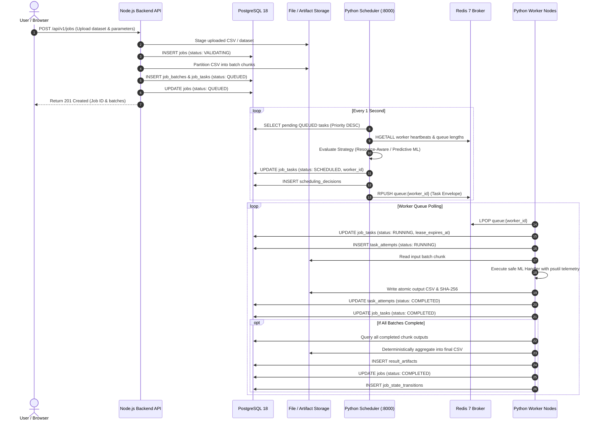

# System Architecture & Service Boundaries

## 1. Architectural Philosophy
The **Distributed AI/ML Job Processing Platform** is architected as an asynchronous, event-driven, decoupled distributed system. No single point of state failure exists between the presentation layer, the API server, the scheduler, the message broker, and the worker execution tier.

Authoritative state is managed exclusively in PostgreSQL using transactional integrity. Ephemeral coordination, fast worker heartbeats, and queue dispatch are managed through Redis.

---

## 2. Component Boundaries & Interaction

---

## 3. Communication Protocols
- **Client to Backend**: HTTP/1.1 REST API + WebSocket (Socket.IO) for real-time progress broadcasts.
- **Backend to PostgreSQL**: Native PostgreSQL connection pool (`pg`) over TCP port 5432 with explicit transaction scopes (`BEGIN` / `COMMIT` / `ROLLBACK`).
- **Scheduler to Redis & PostgreSQL**: Direct low-latency TCP connections for task polling and telemetry caching.
- **Workers to Compute & Broker**: Task queues isolated via `queue:{worker_id}`. Real-time telemetry published to `worker:{worker_id}:heartbeat` with 20-second TTLs.
